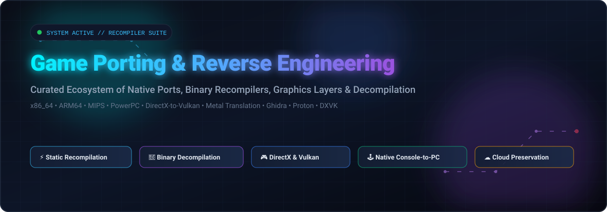

# Awesome-Game-Porting-Reverse-Engineering

  

  

  

  

  

  

# 🛠️ Top Game Porting & Reverse Engineering

**Curated List of SaaS/Commercial Platforms & Open-Source GitHub Projects**  

*Focused on Console-to-PC Native Ports, Binary Decompilation & Static Recompilation, Graphics/OS Translation Layers (Wine/DXVK/MoltenVK) & Reverse-Engineering Suites*  

**Last updated: November 2026**

This repository tracks notable **SaaS/Commercial platforms** and **open-source projects** for **Game Porting & Reverse Engineering**. These tools power console-to-PC native game ports (`fifa-street-pc-port`, `Ship of Harkinian`, `Zelda64Recomp`, `UnleashedRecompiled`), static binary recompilation (`N64Recomp`, `XenonRecomp`), decompilation and assembly-matching suites (`Ghidra`, `Radare2`, `Rizin`, `decomp.me`), DirectX-to-Vulkan/Metal graphics translation (`DXVK`, `vkd3d-proton`, `MoltenVK`), and cross-architecture execution (`Wine`, `Proton`, `Box64`) for preservation engineers and reverse-engineering developers.

**Examples** include GeForce NOW (NVIDIA), Boosteroid, Shadow PC (OVHcloud / Octave Klaba), Antstream Arcade, Utomik, LaunchBox / Big Box (Unbroken Software), RetroArch (Libretro Cloud / Store Ecosystem), Playnite (Hosted Addon/Metadata Ecosystem), Batocera.linux (Hosted OS Ecosystem), and Recalbox (Commercial Hardware/Kit Ecosystem) (the category leaders).

**🚀 Open-source emphasis**: This section is heavily expanded with every major active project for community console-to-PC ports (`samuelit0davila/fifa-street-pc-port`, `OpenMW`, `DevilutionX`, `OpenRCT2`, `Ship of Harkinian`), static binary recompilers (`N64Recomp`, `XenonRecomp`), reverse-engineering & decompilation suites (`Ghidra`, `Rizin / Cutter`, `decomp.me`, `ImHex`, `RenderDoc`, `Frida`), and graphics/OS porting layers (`Wine`, `Proton`, `DXVK`, `MoltenVK`, `Box64`) — ideal for preservationists and porting engineers.

🤝 Contributions welcome! Open a PR to add/update entries. Keep descriptions factual and link to official sites.

## 📑 Table of Contents

- [📊 Sector Overview & Market Dynamics](#-sector-overview--market-dynamics)

- [☁️ SaaS/Hosted & Commercial Platforms](#️-saashosted--commercial-platforms)

- [💻 Open-Source GitHub Projects](#-open-source-github-projects)

- [🛠️ How to Contribute](#️-how-to-contribute)

- [⚠️ Disclaimer](#️-disclaimer)

- [💖 Support & Thank You](#-support--thank-you)

## 📊 Sector Overview & Market Dynamics

The global Cloud Gaming, Game Preservation & Cross-Platform Porting Tools market is valued at approximately **$10.5B–$13.8B in 2026** (projected to reach over $25B by 2030, expanding at a ~24% CAGR). The commercial cloud gaming and managed emulation sector is **moderately concentrated among market leaders** like NVIDIA GeForce NOW, Boosteroid, and Shadow PC due to intense GPU infrastructure capital requirements, while the surrounding emulation frontend, game-porting runtime, and binary reverse-engineering tools ecosystem remains **highly fragmented and dominated by community-driven open-source projects**.

## ☁️ SaaS/Hosted & Commercial Platforms

*Sorted descending by company valuation / annual revenue scale.*

| Platform | Description | Company Scale (Valuation / Revenue) | Starting Paid Tier | Free Tier / Trial Limit |
| :--- | :--- | :--- | :--- | :--- |
| **[GeForce NOW (NVIDIA)](https://nvidia.com)** | Cloud RTX GPU game-streaming platform running PC libraries from Steam, Epic, Xbox, and GOG across Windows, macOS, Linux, browsers, and handhelds. | **Part of NVIDIA Corp.** (~$130B+ annual revenue; ~$3T+ market cap) | **$9.99 / month** ($49.99 / 6 months Performance) or **$19.99 / month** ($99.99 / 6 months Ultimate RTX 4080) | **Forever Free Basic Tier** (Ad-supported, **1-hour session limit** per session with standard queue access) |
| **[Shadow PC (OVHcloud / Octave Klaba)](https://shadow.tech)** | Dedicated cloud Windows 11 gaming and reverse-engineering workstation streamed at low latency to macOS, Linux, iOS, and Android. | **Backed by Octave Klaba / OVHcloud** (~€1B+ OVHcloud group revenue) | **$19.99 / month** (Shadow PC Lite/Discovery) or **$32.99 – $49.99 / month** (Boost / Power RTX GPU tiers) | **No Free Tier / 0-Day Trial** (Requires paid upfront subscription; access to test network ping and speed tool prior to purchase) |
| **[Boosteroid](https://boosteroid.com)** | Leading European independent cloud gaming platform streaming AAA and classic PC titles at up to 4K/120fps across Linux, macOS, browsers, and TVs. | **~$100M–$200M Est. Valuation** (~$20M–$40M est. ARR) | **€7.49 / month** (billed annually at €89.89/year) or **€12.89 / month** monthly for Ultra 4K | **No Free Tier / 0-Day Trial** (Free account includes in-browser latency and network speed diagnostic tool before purchasing) |
| **[Antstream Arcade](https://antstream.com)** | Official cloud retro-gaming platform streaming 1,300+ licensed arcade, Amiga, Commodore, SNES, and PlayStation classics with cloud saves. | **~$30M–$50M Est. Valuation** (~$5M–$10M est. ARR; $20M+ venture funding) | **$3.99 / month** ($39.99 / year billed annually) or **$99.99 one-time** Lifetime Pass | **Forever Free Tier** (Ad-supported gameplay with 1,300+ retro games, daily challenges, and tournaments supported by pre-roll ads) |
| **[Utomik](https://utomik.com)** | Subscription cloud and fast-chunked-download PC/retro gaming platform curating 1,400+ indie, classic, and family titles on PC and smart TVs. | **~$15M–$30M Est. Valuation** (~$5M+ est. ARR) | **$8.99 / month** (PC Only Plan) or **$11.99 / month** (Cloud + PC Multi-screen Plan) | **14-Day Free Trial** (Full unlimited access to 1,400+ games across PC/Cloud for 14 days, converts to paid plan unless cancelled) |
| **[LaunchBox / Big Box (Unbroken Software)](https://launchbox-app.com)** | Windows/Android retro-game launcher, metadata scraper, and 10-foot arcade cabinet frontend integrating emulators and native PC ports. | **~$5M–$15M Est. Scale** (Profitable independent retro software company) | **$30.00 / year** (1-year license with updates) or **$75.00 one-time** Forever Updates license for Big Box mode | **Forever Free Desktop Tier** (Unlimited game library management, emulation launching, metadata scraping, and community integrations) |
| **[Recalbox (Commercial Hardware / RGB Dual Ecosystem)](https://recalbox.com)** | Open-source retro-gaming OS paired with official Recalbox RGB Dual CRT hardware adapters, pre-flashed kits, and Patreon early builds. | **~$2M–$5M Est. Scale** (Commercial hardware sales & accessories) | **€39.00 – €89.00 one-time** (Hardware kits / RGB Dual CRT adapters; core OS is free) | **Forever Free OS** (Unlimited free downloadable bootable images for Raspberry Pi, PC, and handheld devices with 100+ emulators) |
| **[RetroArch (Libretro Cloud / Store Ecosystem)](https://retroarch.com)** | Cross-platform frontend for Libretro cores running hundreds of open-source emulators and native game-engine ports with netplay and CRT shaders. | **Non-Profit / Community Scale** ($150K–$300K/year Patreon & OpenCollective funding) | **$0.00 / Free Open-Source** (Optional Patreon donations from $1 to $50/month) | **Forever Free & Open-Source** (Unrestricted access to all Libretro cores, netplay, shaders, and cross-platform releases on Steam/App Stores) |
| **[Playnite (Hosted Addon & Metadata Ecosystem)](https://playnite.link)** | Open-source unified PC and emulated/ported game library manager with hosted plugin/theme repositories and full-screen controller UI. | **Community Project Scale** ($20K–$50K/year Patreon donations) | **$0.00 / Free Open-Source** (Optional Patreon support) | **Forever Free & Open-Source** (Unrestricted MIT license for full desktop & fullscreen mode, scraper plugins, and cloud integrations) |
| **[Batocera.linux (Hosted OS & Content Ecosystem)](https://batocera.org)** | Plug-and-play retro-gaming Linux OS distribution with hosted theme/bezel repositories supporting x86_64, Raspberry Pi, and ARM handhelds. | **Community Project Scale** ($15K–$40K/year OpenCollective & donations) | **$0.00 / Free Open-Source** (100% free bootable OS) | **Forever Free & Open-Source** (Unrestricted access to complete bootable OS, emulator cores, scraping, and themes with no usage limits) |

## 💻 Open-Source GitHub Projects

| Project | License / Hosting Cost | Free Tier / Self-Hosted Limit | Description |

| :--- | :--- | :--- | :--- |
